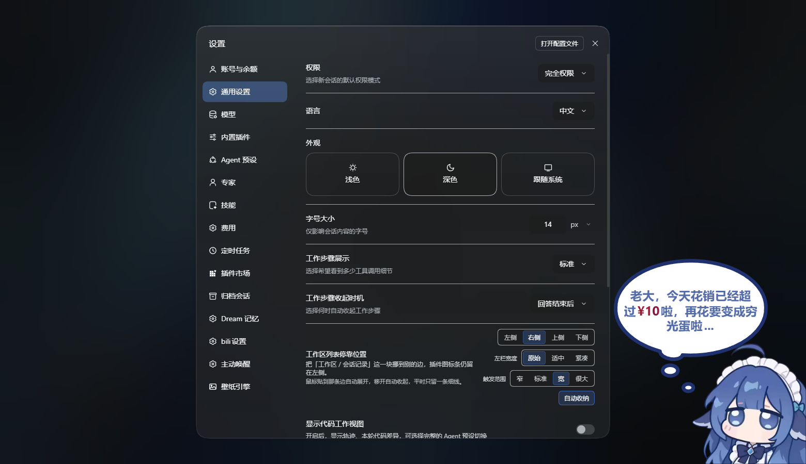
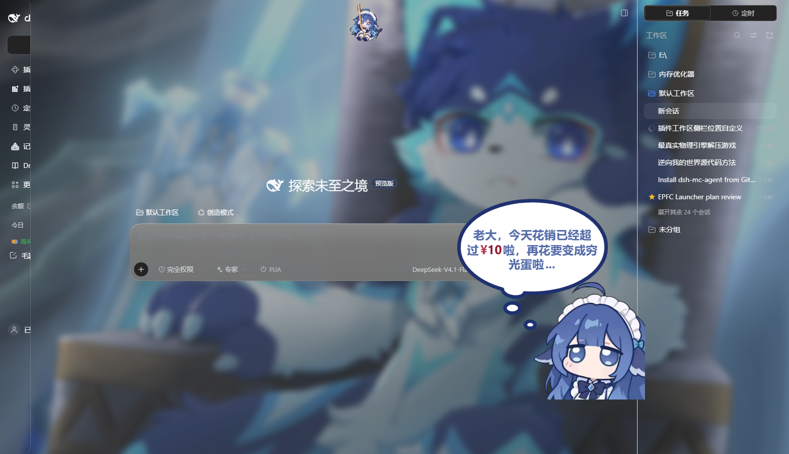
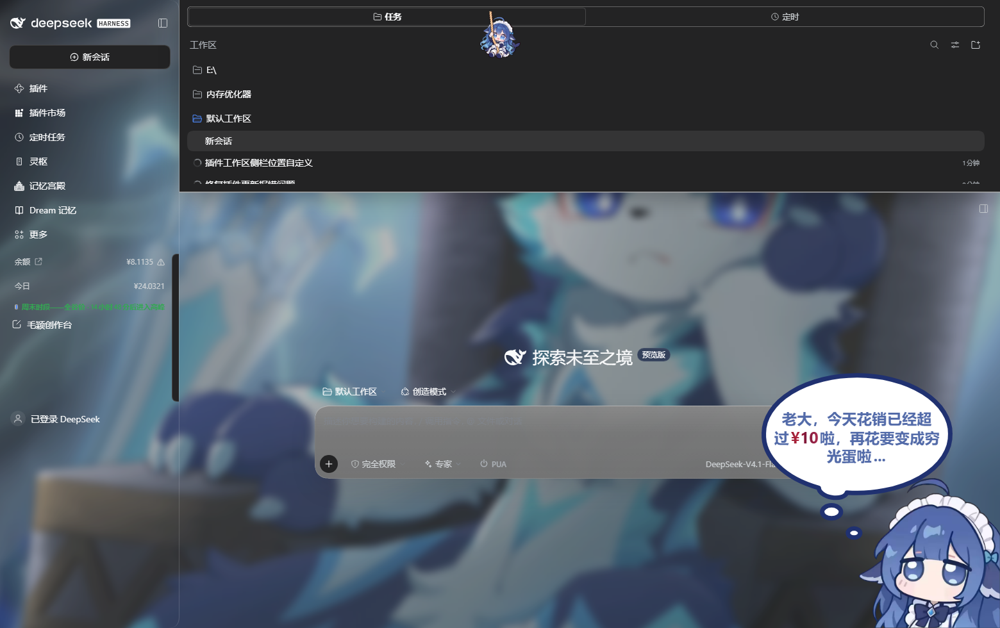

# dsh-sidebar-dock

把 **DeepSeek Harness（DSH）左栏里「工作区 / 会话记录」那一块**单独停靠到 **左 / 右 / 上 / 下**
任意一边，插件图标条、品牌行、底部设置钮留在原位 —— 用来解决「左侧栏插件装太多、会话列表被挤得没法看」。

Dock the **workspace / session list** of DeepSeek Harness to the left, right, top or bottom edge,
leaving the plugin rail where it is. Switchable at runtime in **Settings → General**.

| 设置行 | 右侧停靠 | 上侧停靠 + 自动收纳展开 |
| --- | --- | --- |
|  |  |  |

## 功能

- **四向停靠**：左侧（默认，等于不改） / 右侧 / 上侧 / 下侧，点一下立即生效，无需重启。
  「工作区 / 会话记录」跟着宿主数据自动更新 —— 以后新建的工作区、会话照常出现在那一侧。
- **左栏宽度**：`原始`（保持宿主宽度，默认） / `适中 176px` / `紧凑 112px`。停靠到别的边时，
  左栏会按这个宽度收窄，把空间还给会话内容。
- **自动收纳**：面板平时收成贴边 5px 的一条线，鼠标贴到那条边才展开；移开 420ms 后自动收起。
- **触发范围**：`窄 32 / 标准 64 / 宽 104 / 很大 160` px —— 触发带只监听 `pointermove`，
  本身不可见、不接收点击，所以放大后也不会挡住任何按钮。
- 所有状态存 `localStorage`；卸载或禁用插件即自动还原宿主布局（不写宿主文件、不改宿主配置）。

## 安装

本插件是一个 DSH **bundle**（`package.json` 里声明 `dsh.bundle.patch`）。

**方式一（推荐）** —— 在 DSH 的 Agent 会话里让它安装这个目录：

```
plugin_manager action=install_bundle target=<本仓库的绝对路径>
```

它会把自己加进 profile 依赖并自动 enable，返回 `application: applied` 即生效。

**方式二** —— 命令行（只加依赖，之后还要在「插件」界面把 bundle 打开）：

```bash
dsh plugin --profile <profile-name> add <本仓库的绝对路径>
```

装好（或改了 `client.js`）之后，**已经在跑的窗口需要重载一次页面 / 重启软件端**才会拿到新的
client 模块（DSH 的插件集合在启动时定型，应用内的「刷新」按钮在部分版本上救不了）。

卸载：在「插件」界面关掉 / 移除该 bundle。`localStorage` 里的几个键可以留着，下次装回来直接生效。

## 设置项

**设置 → 通用 → 工作区列表停靠位置**

| 控件 | 取值 | `localStorage` 键 |
| --- | --- | --- |
| 停靠位置 | `左侧` / `右侧` / `上侧` / `下侧` | `dsh-sidebar-dock/position` |
| 左栏宽度 | `原始` / `适中 176px` / `紧凑 112px` | `dsh-sidebar-dock/rail` |
| 触发范围 | `窄 32` / `标准 64` / `宽 104` / `很大 160` px | `dsh-sidebar-dock/zone` |
| 自动收纳 | 开 / 关 | `dsh-sidebar-dock/peek` |

想恢复原样：把停靠位置点回 `左侧`，或清掉上面几个键。

## 原理（为什么是样式表）

宿主 `@deepseek-ai/dsh-client-ui-layout` 的三列 grid 写死在 AppFrame 里，`ctx.layout` 只暴露
`toggleSidebar / openRightbar / closeRightbar / selectPanel`，没有「换边」的 API；而
`sidebar.workspaces` 是 `@deepseek-ai/dsh-client-ui-sidebar` 内部渲染的，插件无法把它挂到别的 slot。
所以这里走**最小侵入的样式表**：

1. `apply()` 之后用 **DOM 顺序锚点**认列：`[data-shell-bottom]` 的父节点是 frame，它前面的 3 个元素
   兄弟依次是 `sidebar / center / rightbar`（`DocumentTitle` 渲染 null，不占位），再给
   `[data-slot="sidebar.workspaces"]` 打上 `data-dssb-tree`。
2. `measure()` 从宿主**自己的计算轨道**（`getComputedStyle(frame).gridTemplateColumns`）读回列宽，
   算出 `--dssb-rail`（左栏视觉宽）、`--dssb-rail-width`、`--dssb-pull`、`--dssb-right-rail`；
   窗口缩放、右栏开合都会重算 —— 宽度从不写死。
3. 一张包自有样式表按 `html[data-dssb-pos]` / `html[data-dssb-peek]` 生效：
   - `left`（默认）：**一条规则都不写**，与宿主完全一致；
   - 停靠在别处：左栏按 `--dssb-rail-width` 收窄，center 用 `margin-left:-pull` 贴过来（不留空档），
     整棵树 `position:fixed` 停到目标边，center 用 padding 让出面板厚度，**不覆盖会话**。
4. 卸载 / 禁用时移除属性、样式表、数据标记和测得的自定义属性，布局自动还原。

### 踩过的坑（留档）

- **`height:5px` 收不到 5px**：元素是 `box-sizing:border-box`，padding 合计 20px + border 0.5px，
  border-box 下 used height 被撑到 21px。收起态必须同时 `padding:0`。
- **设置行显示 `position.title`**：内联词典是嵌套的（`{position:{title}}`），查找却用扁平键。
  现在按点路径取，并且 `props.t` → locale 命名空间 → 内置词典逐级回退，最坏也不显示键名。
- **壁纸主题下穿模**：`--dsw-specific-sidebar-fill` 是半透明的，会话文字会透上来。改用
  `--dsw-alias-bg-base` + `--dsw-alias-bg-layer-1` 渐变 + `backdrop-filter: blur(18px)`。
- **`renderSlot` 的占位元素是 `display:contents`**：要给它的子节点打 `position:fixed` 前必须先
  `display:flex !important`，否则没有盒子。
- **收起侧栏时树是空的**：`WorkspaceBrowser` 在 `wide=false` 时只渲染图标变体。所以停靠在非左侧时
  先通过公开的 `ctx.layout.toggleSidebar()` 展开侧栏；若仍收着就**不接管布局**并在设置行提示。

## 已知边界

- 侧栏收起（rail 态）时插件不接管布局，设置行会提示先展开。
- 非左侧停靠时宿主的分栏拖拽把手会隐藏：它的 `left` 是按默认 lane 算的像素值，换边后必然错位。
  改回「左侧」即恢复。
- 右栏（rightbar / better-sidebar 等）保持原位，面板会让开它；但其它插件自己的固定层
  （例如顶部 tab、右下气泡）z-index 更高，可能压住面板边角。
- DSH 升级后宿主 class 名可能变（hash 前缀）。本插件不依赖 class 名，只依赖
  `data-shell-bottom` / `data-rightbar-col` / `data-slot="sidebar.workspaces"` 这几个稳定属性。
- 官方 `ui-plugin.md` 建议「挑一个已经分配好空间的 slot，不要读别人的 DOM」。本需求物理上做不到
  （宿主不给换边 API，slot 里也没有可放树的位置），因此采用**只加可移除样式 + 自己的 data 属性**
  的最小侵入方案，并把边界写在这里。

## 目录结构

```
.
├── client.js           # Client 半：标记 / 测量 / 样式表 / 指针揭示 / 设置行（全部逻辑）
├── index.js            # Host 半（空实现，只为保住 Loader 行）
├── cordis.patch.yml    # bundle 的 insert 行
├── locale/{zh,en}.json # meta.title / description 与行文案
├── icon.svg            # 插件图标
├── docs/               # README 截图
├── CHANGELOG.md
└── LICENSE
```

## 开发

```bash
node --check client.js     # 语法检查（CSS 是模板字符串，注意别在注释里写反引号）
```

- 以 `link:` 方式装进 profile 后，改源码即时生效，只需重载页面。
- 设置行走 `ctx.slots.register({ name, id, order }, DockRow)`，标题、控件、描述全部自绘
  （`settings.general.item` 不向 occupant 投影任何 label）。
- 想换包名 / 发到 npm：改 `package.json` 的 `name`（例如 `dsh-sidebar-dock`）后重装一次 bundle 即可，
  `client.js` 里的 `NS` 不需要跟着改。

## License

[MIT](LICENSE)
